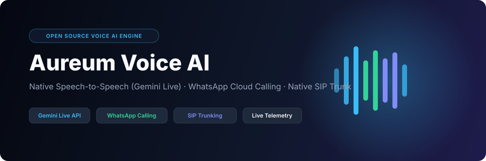
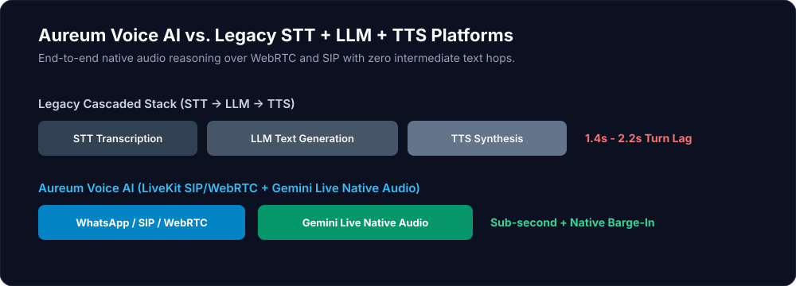
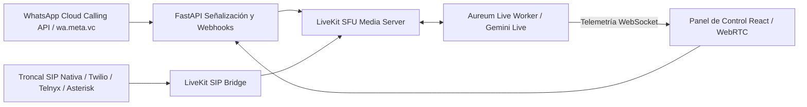

<p align="right">
  <a href="./README.md">🇺🇸 Read in English</a>
</p>

<p align="center">
  
</p>

<p align="center">
  
  
  
  
  
</p>

# Aureum Voice AI

Motor open source y auto-hospedable de **IA de voz nativa Speech-to-Speech**, construido con **Gemini Live API**, **FastAPI**, **LiveKit WebRTC/SIP** y un **Panel de Control en React en tiempo real**. En lugar de encadenar pipelines lentos de `STT → LLM → TTS`, Aureum Voice AI transmite audio bidireccional nativo hacia Gemini Live y conecta llamadas tanto por **WhatsApp Business Calling API** como por **Troncales SIP Nativas** (Twilio, Telnyx, Asterisk, FreeSWITCH).

---

## Por qué Speech-to-Speech nativo + Telefonía dual

<p align="center">
  
</p>

---

## Arquitectura del sistema



---

## Estructura del repositorio

```text
aureum-voice-ai/
├── docker-compose.yml               # LiveKit SFU, Redis, SIP Bridge, FastAPI, Worker y Dashboard
├── .env.example                     # Credenciales Gemini Live, LiveKit, WhatsApp Calling y SIP
├── backend/
│   ├── app/
│   │   ├── main.py                  # Señalización FastAPI, webhooks WhatsApp y telemetría WS
│   │   ├── whatsapp_calling.py      # Cliente Meta Graph API (pre_accept / accept / SIP wa.meta.vc)
│   │   ├── livekit_sip.py           # Gestor de troncales SIP entrantes/salientes y dispatch rules
│   │   └── models.py                # Esquemas Pydantic de configuración y llamadas
│   └── worker/
│       └── agent.py                 # Worker Gemini Live Native Audio + herramientas CRM/agenda
└── frontend/
    └── src/App.tsx                  # Panel de control en vivo (Selector de canal, dialer, transcripts)
```

---

## Inicio rápido

```bash
git clone https://github.com/stephanocamoretti-dotcom/aureum-voice-ai.git
cd aureum-voice-ai
cp .env.example .env
# Completa GEMINI_API_KEY, credenciales de WhatsApp Calling y/o tu troncal SIP
docker compose up --build
```

- **Panel de Control**: `http://localhost:5173`
- **API y Documentación OpenAPI**: `http://localhost:8000/docs`
- **Webhook de Llamadas WhatsApp**: `POST /webhooks/whatsapp/calls`

---

## Ideas de escalado para producción

1. **WhatsApp SIP Nativo (`wa.meta.vc`)**: Activa SIP en tu número de WhatsApp Business desde Graph API `settings` para enrutar llamadas de WhatsApp directamente a `livekit-sip` sobre TLS + SRTP/Opus sin código extra de SDP.
2. **Reglas de despacho multi-tenant**: Asocia cada número DID de tus clientes a un `agent_id` en Redis/Postgres para que un solo clúster atienda a cientos de empresas con prompts y webhooks CRM aislados.
3. **Tool Calling asíncrono con Extended Thinking**: Cambia a `gemini-3.8-live-extended-thinking` cuando el agente necesite consultar ERPs o pasarelas de pago durante la llamada mientras mantiene conectores conversacionales naturales.
4. **Autoescalado horizontal de workers**: Despliega `backend/worker/agent.py` en Kubernetes o ECS para asignar un worker dedicado de baja latencia por cada llamada entrante.

---

## Referencias

- [Integración de Gemini Live API con LiveKit Agents](https://docs.livekit.io/agents/models/realtime/gemini/)
- [Documentación de Telefonía y SIP Trunking en LiveKit](https://docs.livekit.io/telephony/)
- [Meta WhatsApp Business Calling API — Documentación Oficial](https://developers.facebook.com/documentation/business-messaging/whatsapp/calling)
- [Guía de configuración SIP para WhatsApp Business Calling (`wa.meta.vc`)](https://developers.facebook.com/documentation/business-messaging/whatsapp/calling/sip)
- [Resumen oficial de Gemini Live API — Google AI for Developers](https://ai.google.dev/gemini-api/docs/live)
