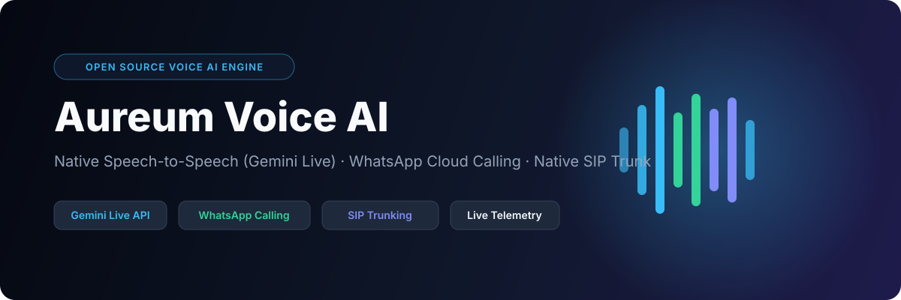
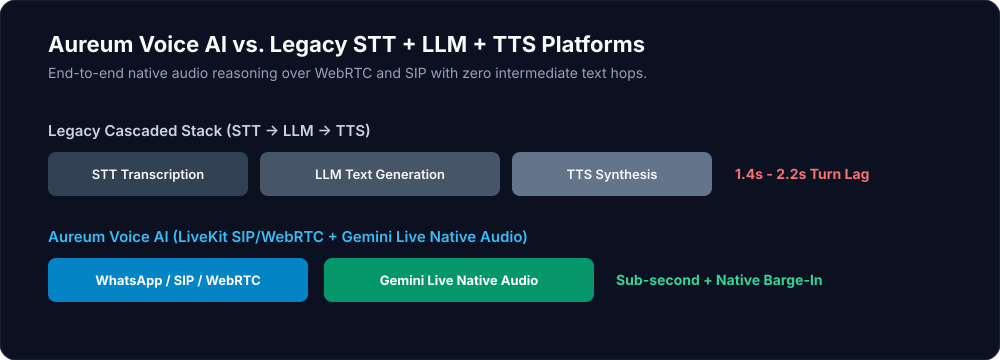
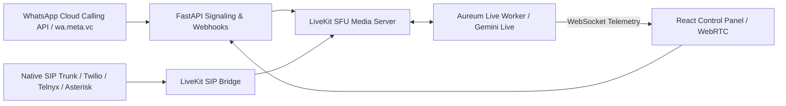

<p align="right">
  <a href="./README.es.md">🇪🇸 Leer en Español</a>
</p>

<p align="center">
  
</p>

<p align="center">
  
  
  
  
  
</p>

# Aureum Voice AI

An open-source, self-hostable **native Speech-to-Speech Voice AI engine** built on **Gemini Live API**, **FastAPI**, **LiveKit WebRTC/SIP**, and a **real-time React Control Panel**. Instead of chaining slow `STT → LLM → TTS` pipelines, Aureum Voice AI streams raw audio bidirectionally to Gemini Live and bridges calls across **WhatsApp Business Calling API** and **Native SIP Trunks** (Twilio, Telnyx, Asterisk, FreeSWITCH).

---

## Why Native Speech-to-Speech + Dual Telephony

<p align="center">
  
</p>

---

## System Architecture



---

## Repository Structure

```text
aureum-voice-ai/
├── docker-compose.yml               # LiveKit SFU, Redis, SIP Bridge, FastAPI, Worker, Dashboard
├── .env.example                     # Gemini Live, LiveKit, WhatsApp Calling & SIP credentials
├── backend/
│   ├── app/
│   │   ├── main.py                  # FastAPI signaling, WhatsApp webhooks & WebSocket telemetry
│   │   ├── whatsapp_calling.py      # Meta Graph API client (pre_accept / accept / wa.meta.vc SIP)
│   │   ├── livekit_sip.py           # LiveKit SIP Inbound/Outbound Trunk & Dispatch Rule manager
│   │   └── models.py                # Pydantic config & call schemas
│   └── worker/
│       └── agent.py                 # Gemini Live Native Audio worker + async CRM/booking tools
└── frontend/
    └── src/App.tsx                  # Live Control Panel (Channel switcher, dialer, transcripts)
```

---

## Quick Start

```bash
git clone https://github.com/stephanocamoretti-dotcom/aureum-voice-ai.git
cd aureum-voice-ai
cp .env.example .env
# Fill in GEMINI_API_KEY, WhatsApp Calling credentials, and/or SIP trunk details
docker compose up --build
```

- **Control Panel**: `http://localhost:5173`
- **FastAPI Signaling & Docs**: `http://localhost:8000/docs`
- **WhatsApp Calling Webhook**: `POST /webhooks/whatsapp/calls`

---

## Scaling Ideas for Production

1. **WhatsApp Native SIP (`wa.meta.vc`)**: Enable SIP on your WhatsApp Business number via Meta Graph API `settings` so WhatsApp calls route directly into `livekit-sip` over TLS + SRTP/Opus without custom WebRTC SDP glue.
2. **Multi-Tenant Dispatch Rules**: Map each client's DID / phone number to a dedicated `agent_id` in Redis or Postgres so one worker cluster serves hundreds of businesses with isolated prompts and CRM webhooks.
3. **Async Tool Calling with Extended Thinking**: Switch to `gemini-3.8-live-extended-thinking` when agents must query external ERPs or payment APIs mid-call while speaking natural conversational fillers.
4. **Horizontal Worker Autoscaling**: Deploy `backend/worker/agent.py` on Kubernetes or Cloud Run / ECS with LiveKit's job queue so each incoming SIP or WhatsApp call gets a dedicated low-latency worker.

---

## References

- [Gemini Live API — LiveKit Agents Integration](https://docs.livekit.io/agents/models/realtime/gemini/)
- [LiveKit Telephony & SIP Trunking Documentation](https://docs.livekit.io/telephony/)
- [Meta WhatsApp Business Calling API Overview](https://developers.facebook.com/documentation/business-messaging/whatsapp/calling)
- [WhatsApp Business Calling — SIP Configuration Guide (`wa.meta.vc`)](https://developers.facebook.com/documentation/business-messaging/whatsapp/calling/sip)
- [Gemini Live API Official Overview — Google AI for Developers](https://ai.google.dev/gemini-api/docs/live)
